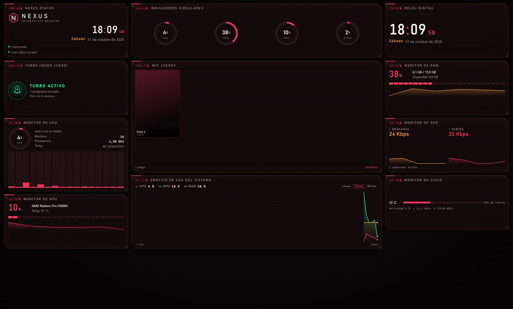
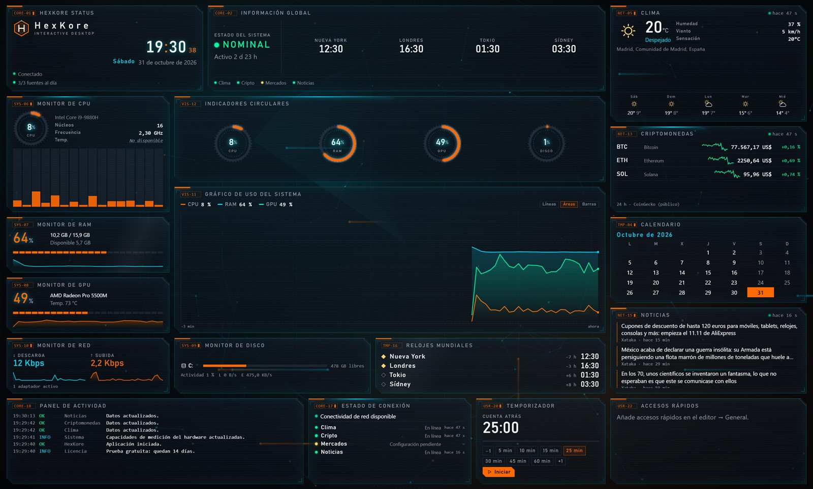
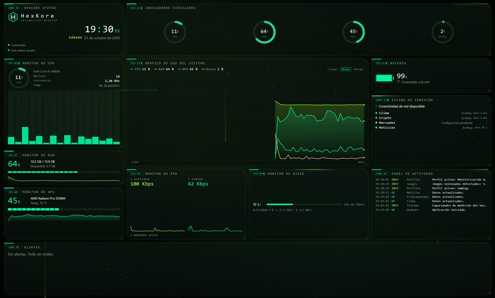
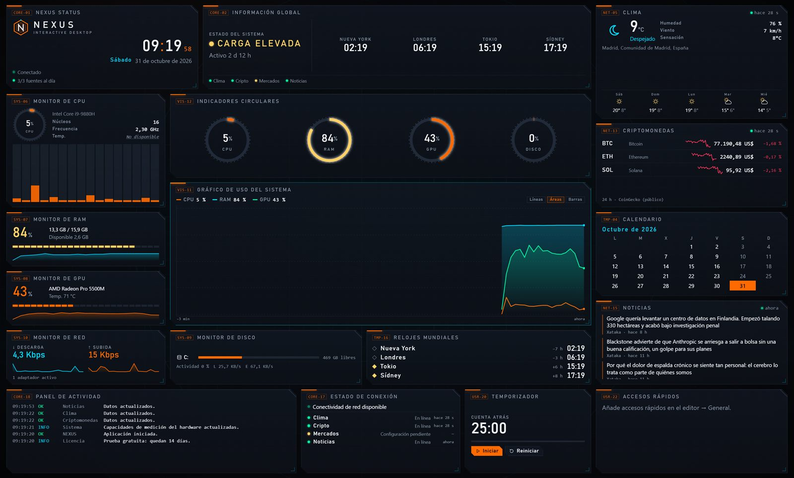
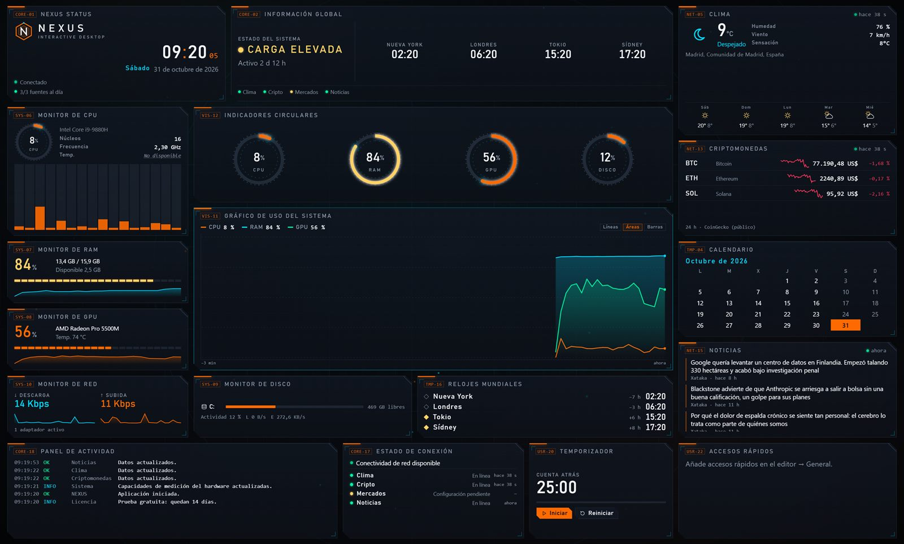
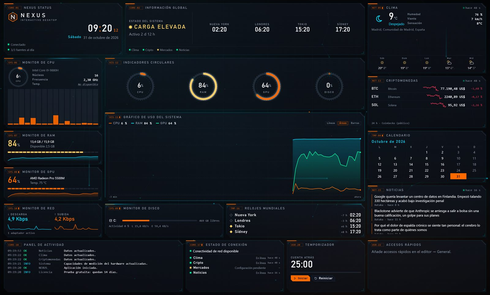
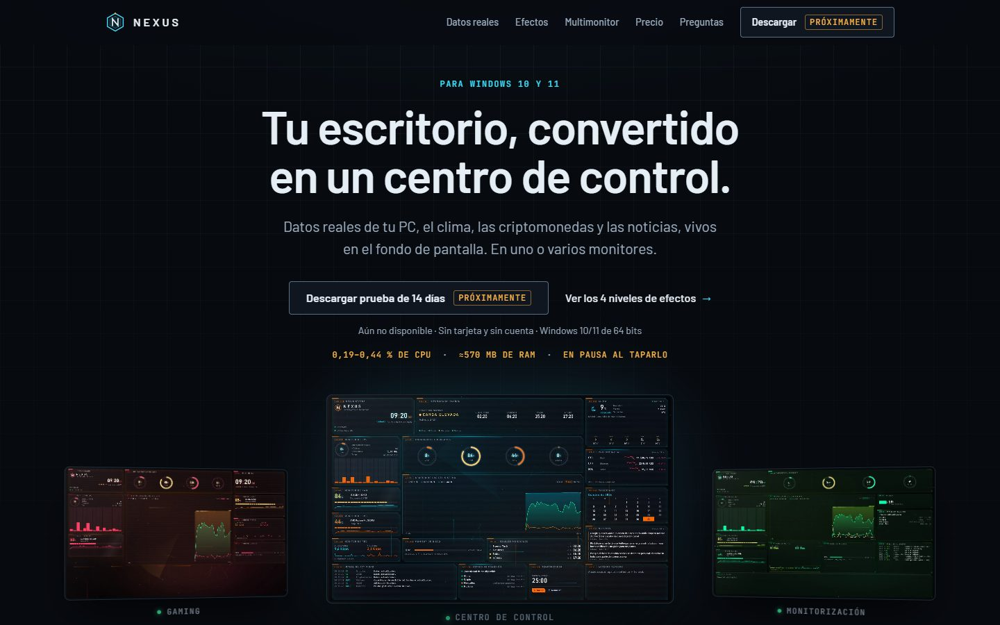

  

  
  
  

<b>Datos reales de tu PC, el clima, las criptomonedas y las noticias, vivos en el fondo de pantalla. En uno o varios monitores.</b>

---

## Tres monitores, tres perfiles

<table>
  <tr>
    <td width="33%"></td>
    <td width="33%"></td>
    <td width="33%"></td>
  </tr>
  <tr>
    <td align="center">GAMING</td>
    <td align="center">CENTRO DE CONTROL</td>
    <td align="center">MONITORIZACIÓN</td>
  </tr>
</table>

Cada pantalla lleva su propio perfil. Hay seis incluidos: Centro de control, Trabajo, Trading, Gaming, Minimalista y Monitorización.

## Lo que consume, medido

| Procesador | Memoria | Si un juego o una ventana lo tapa | Cuentas y telemetría |
|:---:|:---:|:---:|:---:|
| **0,19–0,44 %** | **≈570 MB** | **Pausa** | **0** |
| según el nivel de efectos | todos los procesos | deja de dibujar | licencia sin conexión |

Medido en un Intel i9-9880H con todos los procesos de NEXUS. El uso de la tarjeta gráfica todavía no se ha medido.

## Cuatro niveles de efectos

<table>
  <tr>
    <td></td>
    <td></td>
    <td></td>
    <td></td>
  </tr>
  <tr>
    <td align="center">SIN EFECTOS · 0,19 %</td>
    <td align="center">SUTIL · 0,33 %</td>
    <td align="center">FUTURISTA · 0,36 %</td>
    <td align="center">ESPECTACULAR · 0,44 %</td>
  </tr>
</table>

## Cada dato viene de algún sitio

| | Fuente |
|---|---|
| **Tu PC** | CPU, GPU, RAM, disco, red y batería, cada 2 segundos |
| **Clima** | MET Norway, con pronóstico de 5 días |
| **Cripto** | CoinGecko, con gráfico de 24 h |
| **Noticias** | Las fuentes RSS que tú elijas |
| **Tuyo** | Notas, temporizador, calendario y accesos rápidos |

Si un dato no llega, el widget lo dice. Nunca muestra datos inventados.

## Tu escritorio sigue siendo tuyo

| Atajo | Qué hace |
|---|---|
| <kbd>Ctrl</kbd> + <kbd>Alt</kbd> + <kbd>N</kbd> | Usar notas, temporizador y enlaces |
| <kbd>Esc</kbd> | Volver al escritorio normal |
| <kbd>Ctrl</kbd> + <kbd>Alt</kbd> + <kbd>Mayús</kbd> + <kbd>N</kbd> | Recuperar el escritorio original si algo falla |

  
   La página de presentación: <a href="https://macc961112.github.io/nexus-desktop/">macc961112.github.io/nexus-desktop</a>

---

<b>Sobre este repositorio (para editar la web)</b>

Página estática: HTML, CSS y JS sin dependencias ni compilación. Se publica con GitHub Pages desde la rama `main`.

- `config.js`: enlaces de descarga y compra, precio y correo de soporte. Mientras estén vacíos, los botones muestran «Próximamente». La compra solo se activa con precio y correo.
- `assets/shots/`: capturas reales de la app.
- `assets/readme/`: imágenes de este README (el banner es un SVG animado).
- Ver en local: `node serve.mjs` → http://localhost:5174
- También funciona en Netlify tal cual (incluye `netlify.toml`).

Clima: <a href="https://api.met.no">MET Norway</a> (CC BY 4.0) · Ciudades: © <a href="https://www.openstreetmap.org/copyright">colaboradores de OpenStreetMap</a> · Cripto: <a href="https://www.coingecko.com">CoinGecko</a> · Fuentes: Barlow y JetBrains Mono (SIL OFL)
